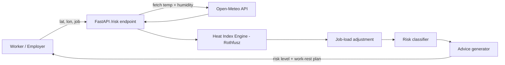

# ThermoSafe: Technical Design

## Architecture

## Components
- **FastAPI service (`main.py`)**: exposes `GET /risk`.
- **Weather source**: Open-Meteo current temperature and humidity (free, no key).
- **Heat index engine**: NWS Rothfusz regression, converted to Celsius.
- **Job adjustment**: +3 C for heavy work, +1.5 C for moderate, 0 for light.
- **Classifier**: Low (<27), Caution (<32), High (<39), Danger (<51), Extreme (51+).

## Planned extensions
- Telegram/WhatsApp/SMS bot with Tamil, Hindi and English alerts
- PostgreSQL for worker registration and alert logs
- React employer dashboard with site-level risk
- Scheduled forecast-based early warnings

## Limitations
Thresholds are simplified from public heat-index guidance and need validation with occupational-health experts before real-world use.
